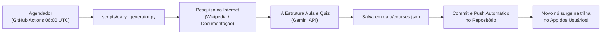

# ⚡ LearnApp - Trilha de Aprendizado Diária com IA

> Aplicativo de estudos com **interface inspirada no Duolingo**, botões grandes, feedback sonoro e **criação 100% autônoma de novas aulas diárias** através de pesquisas na internet e Inteligência Artificial.

---

## 📱 Multiplataforma: Android & Desktop

O projeto foi projetado com uma arquitetura **híbrida e adaptativa**, garantindo a melhor experiência em qualquer dispositivo:

### 🤖 No Android (Smartphone / Tablet)
* **Design Mobile-First:** Botões grandes e táteis com área de toque confortável para o polegar.
* **PWA Instalável:** Pode ser adicionado à tela inicial como um app nativo (sem barra de navegador) via Chrome/Edge.
* **Resposta Háptica:** Vibrações táteis no toque dos botões e ao acertar/errar perguntas.
* **Suporte Offline:** Service Worker que armazena as aulas em cache.
* **Pronto para virar APK:** Pode ser empacotado para a Google Play Store usando **Capacitor**, **Cordova** ou **TWA (Bubblewrap)**.

### 💻 No Desktop (PC / Notebook)
* **Layout em 3 Colunas:** 
  * **Barra Lateral Esquerda:** Logotipo, menu rápido de navegação e lista de atalhos.
  * **Coluna Central:** Trilha de estudos em zigue-zague estilizada.
  * **Barra Lateral Direita:** Calendário de frequência semanal e status do robô de IA.
* **Atalhos Rápidos de Teclado:**
  * <kbd>1</kbd>, <kbd>2</kbd>, <kbd>3</kbd>, <kbd>4</kbd> — Escolher alternativas no Quiz.
  * <kbd>Enter</kbd> ou <kbd>Espaço</kbd> — Confirmar resposta / Avançar lição.
  * <kbd>Esc</kbd> — Fechar modais ou sair da aula.

---

## 🗺️ Estrutura de Tópicos e Subtópicos

O aplicativo organiza o aprendizado em uma árvore hierárquica clara:

```
├── Programação
│   ├── C++  (⚡ Trilha Ativa com aulas diárias geradas)
│   └── Python
└── Idiomas
    └── Inglês
```

### O Caminho de C++:
Cada aula é um **nó 3D** no caminho em curva:
1. **Verde com ✓:** Aula já concluída pelo usuário.
2. **Azul com Efeito Pulso:** Aula atual disponível para iniciar.
3. **Cinza com 🔒:** Próxima aula bloqueada (destravada ao concluir a anterior).
4. **Roxo ✨:** Aula criada hoje pelo robô autônomo de IA.

---

## 🤖 Como funciona a Criação Automática Diária de Aulas

Você não precisa criar conteúdo manualmente. O robô faz tudo sozinho através do script em `scripts/daily_generator.py` e do **GitHub Actions**:



### Testando a geração sem esperar o servidor:
Dentro do próprio aplicativo, clique no botão **"✨ Nova Aula IA"** no topo da tela para ver uma demonstração ao vivo da pesquisa e inserção de uma nova aula no caminho de C++!

---

## 🚀 Como Executar o Projeto

### 1. Abrir no Navegador (Direto):
Basta abrir o arquivo `index.html` em qualquer navegador moderno no seu computador ou celular.

### 2. Ativar no GitHub Pages (Online Grátis):
1. No seu repositório no GitHub, clique em **Settings** > **Pages**.
2. Em **Source**, selecione **Deploy from a branch**.
3. Escolha a branch `main` e a pasta `/ (root)`.
4. Clique em **Save**. Em 1 minuto, seu app estará online em um link público que pode ser acessado de qualquer Android ou PC!

### 4. Compilar o APK Nativo para Android (Kotlin):
O projeto conta com uma estrutura nativa completa em **Kotlin** dentro da pasta `android/`:
* Abra a pasta `android/` no **Android Studio**.
* Conecte seu celular Android via USB ou inicie um emulador.
* Clique no botão verde **Run** ou compile o APK via terminal:
  ```bash
  cd android
  ./gradlew assembleDebug
  ```
* **Build Automático no GitHub Actions:** O workflow `.github/workflows/build_apk.yml` compila o APK automaticamente na nuvem a cada push e disponibiliza o download direto nos Artefatos de Ação do GitHub!

---

## 📂 Estrutura de Arquivos

```
Learn-App/
├── .github/
│   └── workflows/
│       ├── daily_lesson.yml   # Agendador diário de aulas com IA
│       ├── release.yml        # Publicação de novas Releases oficiais
│       └── build_apk.yml      # Compilação automática do APK Android
├── android/                   # 📱 PROJETO ANDROID NATIVO EM KOTLIN
│   ├── app/
│   │   ├── src/main/java/com/learnapp/
│   │   │   ├── MainActivity.kt        # Activity principal em Kotlin
│   │   │   └── WebAppInterface.kt     # Ponte nativa (Vibração e Toasts)
│   │   ├── src/main/assets/           # Web app embutido para uso 100% offline
│   │   └── AndroidManifest.xml
│   ├── build.gradle.kts       # Configuração raiz do Gradle
│   └── settings.gradle.kts
├── css/
│   └── styles.css             # Estilos responsivos Desktop & Mobile
├── data/
│   └── courses.json           # Banco de dados das aulas em JSON
├── js/
│   ├── app.js                 # Lógica da trilha, player e atalhos
│   └── courses.js             # Base carregada pelo navegador
├── scripts/
│   └── daily_generator.py     # Script autônomo de pesquisa e criação
├── index.html                 # Página principal da aplicação
├── manifest.json              # Configuração PWA para Android
├── sw.js                      # Service Worker para modo offline
└── README.md                  # Documentação do projeto
```
